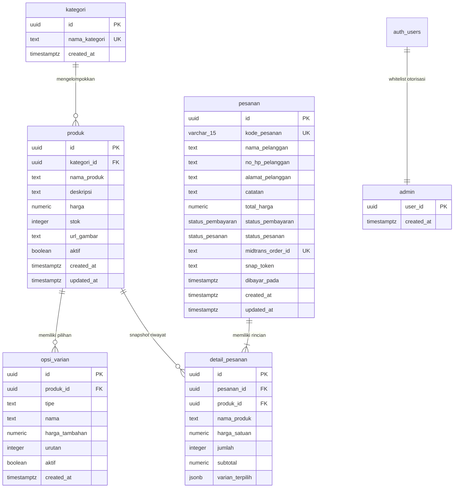

# COMPREHENSIVE TECHNICAL DOCUMENTATION
## ANALISIS ARSITEKTUR, ALUR KERJA, DAN IMPLEMENTASI SOURCE CODE SISTEM WEBSITE
### SISTEM E-COMMERCE PEMESANAN MAKANAN "CLUCKY TAIWAN"

---

## DAFTAR ISI
1. [Fundamental Website dan Konsep Dasar](#1-fundamental-website-dan-konsep-dasar)
2. [Project Structure dan Technology Stack](#2-project-structure-dan-technology-stack)
3. [Arsitektur dan Komunikasi Sistem](#3-arsitektur-dan-komunikasi-sistem)
4. [Analisis Implementasi Frontend](#4-analisis-implementasi-frontend)
5. [Analisis Implementasi Backend](#5-analisis-implementasi-backend)
6. [Analisis Database dan Pengelolaan Data](#6-analisis-database-dan-pengelolaan-data)
7. [Analisis Core Logic dan Eksekusi Kode](#7-analisis-core-logic-dan-eksekusi-kode)
8. [Analisis Implementasi Setiap Fitur](#8-analisis-implementasi-setiap-fitur)
9. [Analisis Keamanan Sistem](#9-analisis-keamanan-sistem)
10. [Debugging, Testing, dan Error Handling](#10-debugging-testing-dan-error-handling)
11. [Kesimpulan Pemahaman Teknis Sistem](#11-kesimpulan-pemahaman-teknis-sistem)
12. [Lampiran Teknis](#12-lampiran-teknis)

---

## 1. FUNDAMENTAL WEBSITE DAN KONSEP DASAR

Untuk memahami arsitektur Clucky Taiwan secara mandiri, berikut adalah pemetaan konsep dasar rekayasa perangkat lunak web dan padanannya dalam sistem ini:

| Konsep Dasar | Definisi Singkat | Implementasi Konkret pada Clucky Taiwan |
|:---|:---|:---|
| **Client & Browser** | Pihak peminta data/tampilan interaktif. | Browser pengguna yang merender Single Page Application (SPA) React 19. |
| **Server** | Komputer pemroses data, logika rahasia, dan basis data. | Deno Runtime pada Supabase Edge Functions dan gateway PostgREST. |
| **Frontend** | Lapisan presentasi visual (UI/UX) di browser klien. | React 19, Tailwind CSS, Lucide Icons, dan Zustand di direktori `src/`. |
| **Backend** | Lapisan logika bisnis, otentikasi, integrasi perbankan. | Supabase Edge Functions (`create-order`, `midtrans-webhook`, `check-order-status`). |
| **Database** | Tempat penyimpanan data terstruktur & relasional (ACID). | PostgreSQL 15+ yang dikelola oleh Supabase Cloud. |
| **HTTP / HTTPS** | Protokol komunikasi data terenkripsi TLS di web. | Seluruh komunikasi client-ke-edge dan webhook Midtrans wajib HTTPS. |
| **Request-Response** | Siklus tanya-jawab antara klien dan server. | Client memanggil `fetch()` POST; Edge Function mengembalikan `Response.json()`. |
| **API & Endpoint** | Antarmuka pemrograman standar dan alamat URL fungsinya. | Endpoint serverless: `/functions/v1/create-order`, `/rest/v1/produk`. |
| **JSON** | Format pertukaran data standar berbasis teks JavaScript. | Format payload checkout, respons API, dan kolom snapshot `jsonb` varian. |
| **Routing** | Pemetaan URL browser ke komponen tampilan. | Client-side routing via `react-router-dom` di `src/App.jsx`. |
| **Middleware** | Lapisan pencegat request (validasi, CORS, autentikasi). | Penanganan CORS pre-flight OPTIONS dan header di Deno runtime. |
| **Authentication** | Verifikasi identitas pengguna ("Siapa Anda?"). | Supabase Auth (Email & Password terenkripsi). |
| **Authorization** | Pembatasan hak akses pengguna ("Apa hak Anda?"). | Whitelist tabel `admin` di database + PostgreSQL Row Level Security (RLS). |

---

## 2. PROJECT STRUCTURE DAN TECHNOLOGY STACK

### 2.1 Identifikasi Stack Teknologi [FOUND IN CODE]
- **Frontend Framework**: React 19 (`^19.0.0`) + React DOM (`^19.0.0`)
- **Build Tooling & Bundler**: Vite (`^7.0.0`) + `@vitejs/plugin-react` (`^4.3.1`)
- **Routing**: React Router DOM (`^6.26.2`)
- **Styling Engine**: Tailwind CSS (`^3.4.10`) + PostCSS (`^8.4.45`) + Autoprefixer
- **State Management**: Zustand (`^5.0.0`) + React Context API
- **UI Primitives**: Vaul (`^1.1.2`) (Drawer/Bottom Sheet), Lucide React (`^1.22.0`)
- **Visualisasi & Pelaporan**: Recharts (`^3.10.1`), XLSX/SheetJS (`^0.18.5`)
- **Feedback & Notifikasi**: React Hot Toast (`^2.6.0`), Web Audio API (`notification.mp3`)
- **Database & BaaS**: PostgreSQL 15+ via Supabase (`@supabase/supabase-js ^2.110.0`)
- **Serverless Backend**: Deno Runtime (TypeScript) pada Supabase Edge Functions
- **Payment Gateway**: Midtrans Snap Engine (Sandbox / Production mode)

### 2.2 Struktur Direktori Proyek
```
clucky-taiwan 2/
├── index.html                   # HTML shell utama (SPA root mount point)
├── package.json                 # Manifest dependensi & script build
├── vite.config.js               # Konfigurasi bundler Vite & manual chunking
├── tailwind.config.js           # Konfigurasi warna, typography, styling token
├── vercel.json                  # Konfigurasi rewrite SPA untuk hosting Vercel
├── .env.example                 # Dokumentasi environment variables
├── docs/                        # Dokumentasi perancangan UML & alur sistem
│   ├── use-case-diagram.md
│   ├── activity-diagrams.md
│   └── TECHNICAL_DOCUMENTATION.md # Dokumen teknis komprehensif ini
├── supabase/
│   ├── config.toml              # Konfigurasi lokal Supabase CLI
│   ├── functions/               # Serverless Backend (Deno / TypeScript)
│   │   ├── create-order/        # Handler checkout, kalkulasi harga, reservasi stok
│   │   ├── check-order-status/  # Handler pelacakan pesanan publik (anti-enumerasi)
│   │   └── midtrans-webhook/    # Handler webhook pembayaran & auto-restock
│   └── migrations/              # SQL DDL/DML, Triggers, RPC, dan RLS Policies
│       ├── 0001_init_schema.sql
│       ├── 0002_add_variants.sql
│       ├── 0003_add_catatan_pesanan.sql
│       ├── 0004_seed_dummy_data.sql
│       ├── 0005_product_images_storage.sql
│       ├── 0006_kode_pesanan.sql
│       ├── 0007_pesanan_replica_identity.sql
│       ├── 0008_pesanan_public_realtime.sql
│       ├── 0009_dibayar_pada.sql
│       └── 0010_patch_backfill_dibayar_pada.sql
└── src/
    ├── main.jsx                 # Entry point React DOM (StrictMode + ErrorBoundary)
    ├── App.jsx                  # Root router, providers, lazy loading routes
    ├── index.css                # Tailwind directives & CSS custom scrollbar
    ├── assets/                  # File statis lokal (audio bel notifikasi, hero image)
    ├── components/              # Komponen visual reusable
    │   ├── admin/               # Komponen khusus backoffice admin
    │   ├── CartDrawer.jsx       # Drawer keranjang belanja (Vaul/CSS)
    │   ├── VariantBottomSheet.jsx # Bottom sheet pemilihan opsi varian
    │   ├── BudgetRecommender.jsx  # Widget rekomendasi menu berbasis budget
    │   ├── CheckoutForm.jsx     # Formulir pemesanan & integrasi Snap modal
    │   ├── OrderStatusChecker.jsx # Widget pelacakan pesanan
    │   ├── ProductCard.jsx      # Card menu dengan badge urgensi stok
    │   ├── ProtectedRoute.jsx   # Route guard otorisasi admin
    │   └── ErrorBoundary.jsx    # React error boundary penangkap crash render
    ├── context/                 # Context API global
    │   ├── AdminAuthContext.jsx # Sesi login & verifikasi whitelist admin
    │   └── OrderNotificationContext.jsx # Audio alarm & pop-up toast pesanan masuk
    ├── hooks/                   # Custom react hooks
    │   ├── useProducts.js       # Query menu, normalisasi varian, rentang harga
    │   └── useOrderRealtime.js  # Realtime subscription status pesanan pelanggan
    ├── layouts/
    │   └── AdminLayout.jsx      # Shell sidebar admin & lifecycle realtime channel
    ├── lib/
    │   └── supabaseClient.js    # Singleton Supabase browser client
    ├── pages/
    │   ├── public/              # HomePage, ProductDetailPage, CheckoutPage, OrderStatusPage
    │   └── admin/               # AdminDashboard, AdminSales, AdminProducts, AdminCategories, AdminLogin
    ├── store/                   # State managers (Zustand)
    │   ├── cartStore.js         # Keranjang belanja ter-persist ke LocalStorage
    │   ├── ordersStore.js       # Store pesanan admin, paginasi, dan sinkronisasi realtime
    │   └── variantModalStore.js # State visibilitas modal varian
    └── utils/                   # Pure utility functions
        ├── budgetRecommender.js # Algoritma kombinasi menu greedy
        ├── exportExcel.js       # Generator file spreadsheet .xlsx
        ├── formatCurrency.js    # Formatter mata uang IDR
        ├── imageUrl.js          # Optimasi CDN URL Supabase Storage
        ├── loadSnap.js          # Injektor dinamis script Snap SDK Midtrans
        ├── storage.js           # Utilitas LocalStorage safe access
        └── validators.js        # Validasi format nomor telepon Indonesia
```

---

## 3. ARSITEKTUR DAN KOMUNIKASI SISTEM

### 3.1 Pola Arsitektur Aktual [INFERRED]
Sistem mengadopsi pola **Serverless Jamstack + Backend-as-a-Service (BaaS) + Event-Driven Realtime**:
1. **Direct-to-Database Reads (PostgREST)**: Frontend membaca katalog menu langsung ke PostgreSQL via PostgREST tanpa server controller perantara, diproteksi oleh Row Level Security (RLS).
2. **Serverless Mutation Boundary**: Seluruh transaksi keuangan dan pengurangan stok wajib melalui Edge Functions (Deno) dengan `service_role` key rahasia untuk menjamin integritas kalkulasi harga di server.
3. **Event-Driven Push Sync**: Layar kasir dan admin tidak melakukan polling HTTP berulang kali, melainkan menerima streaming pembaruan data secara langsung melalui Supabase Realtime WebSocket.

### 3.2 Diagram Arsitektur Keseluruhan
```mermaid
flowchart TD
    subgraph ClientBrowser ["Browser Klien (React 19 SPA)"]
        UI_Pub["Halaman Publik (Home, Detail, Checkout, Tracker)"]
        UI_Adm["Halaman Admin (Dashboard, Sales, Products, Categories)"]
        Zustand_Cart["Cart Store (Persist LocalStorage)"]
        Zustand_Orders["Orders Store (Shared Realtime State)"]
        Midtrans_Snap["Midtrans Snap Modal SDK"]
    end

    subgraph Hosting ["Static Web CDN"]
        Vercel_CDN["Vercel CDN Edge Network"]
    end

    subgraph SupabasePlatform ["Supabase Backend as a Service"]
        PostgREST["PostgREST HTTP Engine (Auto REST API)"]
        RLS["PostgreSQL Row Level Security (RLS)"]
        DB[(PostgreSQL 15+ Database)]
        StorageBucket["Supabase Storage (product-images)"]
        RealtimePub["Supabase Realtime Engine (Postgres WAL)"]
        
        subgraph ServerlessLayer ["Deno Edge Functions"]
            Fn_Create["POST /create-order"]
            Fn_Check["POST /check-order-status"]
            Fn_Webhook["POST /midtrans-webhook"]
        end
    end

    subgraph PaymentGateway ["Midtrans Payment Gateway"]
        Midtrans_API["Midtrans Snap API"]
        Midtrans_Notifier["Midtrans Webhook Dispatcher"]
    end

    Vercel_CDN -.->|Kirim Aset Bundle| ClientBrowser
    UI_Pub -->|Baca Katalog Menu| PostgREST
    UI_Adm -->|CRUD Menu, Kategori, & Query Laporan| PostgREST
    PostgREST -->|Evaluasi Policy| RLS
    RLS -->|Eksekusi Query| DB

    UI_Pub -->|Submit Checkout| Fn_Create
    Fn_Create -->|Validasi Harga & kurangi_stok()| DB
    Fn_Create -->|Minta Snap Token| Midtrans_API
    Midtrans_API -->|Kembalikan Token| Fn_Create
    Fn_Create -->|Simpan Pesanan| DB
    Fn_Create -->|Kirim Token ke Klien| UI_Pub
    UI_Pub -->|Buka Popup Pembayaran| Midtrans_Snap

    UI_Pub -->|Cek Status (Kode + No HP)| Fn_Check
    Fn_Check -->|Query via Service Role Key| DB

    Midtrans_Snap -.->|Pelanggan Membayar| PaymentGateway
    Midtrans_Notifier -->|Kirim Webhook Notifikasi| Fn_Webhook
    Fn_Webhook -->|Verifikasi Signature SHA-512 & Update Status| DB
    Fn_Webhook -.->|Jika Gagal/Expired: tambah_stok()| DB

    DB -->|Pancarkan Perubahan WAL| RealtimePub
    RealtimePub ==>|ws:// Event UPDATE/INSERT| Zustand_Orders
    RealtimePub ==>|ws:// Event UPDATE Status| UI_Pub
    UI_Adm -->|Upload Gambar Produk| StorageBucket
```

---

## 4. ANALISIS IMPLEMENTASI FRONTEND

### 4.1 Routing & Code-Splitting (`src/App.jsx`) [FOUND IN CODE]
Aplikasi memisahkan rute menjadi dua domain:
- **Eager Routes (Jalur Kritis)**: Halaman publik (`HomePage`, `ProductDetailPage`, `CheckoutPage`, `OrderStatusPage`) dimuat langsung agar waktu muat pertama (*First Contentful Paint*) optimal bagi pembeli.
- **Lazy Routes (Admin Splitting)**: Halaman admin (`AdminLogin`, `AdminDashboard`, `AdminSales`, `AdminProducts`, `AdminCategories`, `AdminLayout`) dibungkus dengan `React.lazy()` dan `<Suspense fallback={<AdminFallback />}>` sehingga kode administratif tidak membebani ukuran bundle pembeli publik.

### 4.2 Manajemen State Terdistribusi
- **`useCartStore` (`src/store/cartStore.js`)**:
  - Menyimpan item keranjang menggunakan composite key `makeCartKey(productId, variantIds)`.
  - Mengisolasi penambahan produk yang sama dengan pilihan varian rasa/ukuran yang berbeda.
  - Otomatis tersinkronisasi ke browser LocalStorage dengan kunci `clucky-cart`.
- **`useOrdersStore` (`src/store/ordersStore.js`)**:
  - Menjadi *Single Source of Truth* operasional kasir.
  - Membuka satu kanal koneksi WebSocket bersama (`admin-orders-shared`).
  - Mengelola paginasi 25 item per halaman (`PAGE_SIZE = 25`).
  - Memancarkan sinyal `lastChangeAt` setiap kali ada event database untuk memicu kalkulasi ulang metrik dashboard.
- **`AdminAuthContext` (`src/context/AdminAuthContext.jsx`)**:
  - Memverifikasi sesi login Supabase Auth terhadap whitelist tabel database `admin`.
- **`OrderNotificationContext` (`src/context/OrderNotificationContext.jsx`)**:
  - Mengelola pemutaran audio alarm `notification.mp3` dan toast mengambang saat pesanan baru berstatus lunas tiba.

---

## 5. ANALISIS IMPLEMENTASI BACKEND

Seluruh backend dinamis diimplementasikan sebagai Serverless Functions pada Deno Runtime:

### 5.1 Edge Function: `create-order` (`supabase/functions/create-order/index.ts`)
- **Fungsi**: Gerbang checkout transaksional.
- **Validasi Input**:
  - Memeriksa nama pelanggan dan nomor telepon via regex Indonesia: `/^(\+62|62|0)8[1-9][0-9]{6,10}$/`.
  - Memastikan kuantitas per item berada pada rentang valid ($1 \le qty \le 50$).
  - Memeriksa keunikan ID produk dalam payload untuk mencegah anomali data.
- **Logika Bisnis & Keuangan**:
  - Mengambil harga dasar produk dan harga tambahan varian langsung dari database PostgreSQL.
  - Menghitung ulang total belanja di server: $\text{Total} = \sum (\text{HargaDasar} + \sum \text{EkstraVarian}) \times Qty$.
- **Reservasi Stok Atomik**:
  - Memanggil stored procedure database `kurangi_stok(uuid, int)` secara berurutan.
  - Jika stok salah satu item tidak cukup, fungsi mengeksekusi mekanisme kompensasi `rollbackStock` untuk memulihkan stok item yang sempat berkurang, lalu mengembalikan status HTTP 409 `INSUFFICIENT_STOCK`.
- **Integrasi Midtrans Snap**:
  - Membentuk kode transaksi unik: `CLUCKY-{timestamp}-{uuid}` dan kode pesanan ramah manusia `CTX-{uuid}`.
  - Meminta Snap Token melalui HTTP POST ke API Midtrans menggunakan `MIDTRANS_SERVER_KEY` rahasia.

### 5.2 Edge Function: `midtrans-webhook` (`supabase/functions/midtrans-webhook/index.ts`)
- **Fungsi**: Listener penyelesaian status pembayaran otomatis.
- **Verifikasi Kriptografi (Anti-Tampering)**:
  - Menghitung hash SHA-512 dari gabungan: $\text{order\_id} + \text{status\_code} + \text{gross\_amount} + \text{ServerKey}$.
  - Menolak request jika signature hash tidak identik dengan `signature_key` dari Midtrans.
- **Idempotensi**:
  - Mengecek status pesanan saat ini di database. Jika sudah berada pada status final (`lunas`, `kadaluarsa`, `dibatalkan`, `ditolak`), webhook langsung mengembalikan respons 200 OK tanpa pemrosesan ganda.
- **Pemulihan Stok Otomatis (Auto-Restock)**:
  - Jika transaksi berstatus `kadaluarsa`, `dibatalkan`, atau `ditolak`, sistem secara otomatis memanggil stored procedure database `tambah_stok(uuid, int)` untuk mengembalikan kuantitas barang ke etalase toko.

### 5.3 Edge Function: `check-order-status` (`supabase/functions/check-order-status/index.ts`)
- **Fungsi**: Pelacakan status pesanan pelanggan.
- **Mekanisme Anti-Enumerasi**:
  - Mengharuskan pencocokan ganda: `kode_pesanan` **DAN** `no_hp_pelanggan`.
  - Mencegah penyerang menebak-nebak kode pesanan orang lain untuk melihat data pribadi pembeli.

---

## 6. ANALISIS DATABASE DAN PENGELOLAAN DATA

### 6.1 Entity-Relationship Diagram (ERD) Aktual


### 6.2 Stored Procedures & Triggers PL/pgSQL
1. **`kurangi_stok(p_produk_id uuid, p_jumlah int)`** [FOUND IN CODE]:
   Menggunakan `SELECT stok FROM produk WHERE id = p_produk_id FOR UPDATE` untuk mengunci baris produk selama transaksi. Mencegah kondisi balapan (*race condition/overselling*). Hak eksekusi dicabut dari publik dan hanya diberikan kepada `service_role`.
2. **`tambah_stok(p_produk_id uuid, p_jumlah int)`** [FOUND IN CODE]:
   Menambahkan kuantitas stok kembali saat pesanan dibatalkan atau kedaluwarsa.
3. **`set_dibayar_pada()` & Trigger `trg_pesanan_dibayar_pada`** [FOUND IN CODE]:
   Secara otomatis mengisi kolom `dibayar_pada = now()` saat `status_pembayaran` bertransisi menjadi `'lunas'`, memastikan data laporan omzet harian selalu akurat.

---

## 7. ANALISIS CORE LOGIC DAN EKSEKUSI KODE

### 7.1 Algoritma Rekomendasi Menu Berdasarkan Budget (`budgetRecommender.js`)
Algoritma menggunakan pendekatan kombinatorial *Greedy with Leftover Minimization*:
1. Mengambil harga efektif produk `getEffPrice(p)` yang memperhitungkan varian termurah (`min_price`).
2. Menghasilkan kombinasi 2 item (*Paket Berdua*) dengan mengizinkan menu ganda ($i = j$) jika stok fisik $\ge 2$.
3. Menghasilkan kombinasi 3 item (*Paket Bertiga*) jika anggaran mencukupi minimal $3 \times$ harga menu termurah.
4. Menambahkan menu tunggal (*Menu Satuan*).
5. Mengurutkan kombinasi berdasarkan sisa uang kembalian terkecil (`budget - total`).
6. Melakukan deduplikasi kombinasi menggunakan signature string berurut `id1_id2_id3`.
7. Mengembalikan 3 rekomendasi terbaik ke antarmuka pengguna.

### 7.2 Algoritma Kunci Komposit Keranjang (`cartStore.js`)
```javascript
function makeCartKey(productId, variantIds = []) {
  if (!variantIds || variantIds.length === 0) return productId;
  return `${productId}::${[...variantIds].sort().join("_")}`;
}
```
Algoritma ini menjamin bahwa satu menu yang sama dengan variasi rasa atau ukuran yang berbeda akan dikelola sebagai entri item yang terpisah secara independen di dalam keranjang belanja.

---

## 8. ANALISIS IMPLEMENTASI SETIAP FITUR

### Ringkasan Alur 11 Fitur Sistem:
1. **Katalog & Filter Kategori**: Query menu via PostgREST dengan filter `aktif = true`, badge stok menipis ($\le 5$) dan habis ($= 0$).
2. **Pemilihan Varian**: Drawer bottom sheet (Vaul) dinamis yang mewajibkan pemilihan satu opsi per tipe varian sebelum masuk keranjang.
3. **Keranjang Belanja Persisten**: LocalStorage sync, merge kuantitas otomatis, pembatasan kuantitas sesuai stok fisik.
4. **Rekomendasi Budget**: Rekomendasi kombinasi menu optimal berdasarkan nominal uang pembeli.
5. **Checkout & Pembayaran**: Kalkulasi harga di server, pemotongan stok transaksional, pembukaan popup Midtrans Snap.
6. **Pelacakan Status Pesanan**: Validasi ganda (Kode + No HP) dengan timeline proses dapur dan websocket live update.
7. **Autentikasi Admin Whitelist**: Supabase Auth login yang divalidasi silang terhadap tabel whitelist `admin`.
8. **Dasbor Analitik**: Grafik omzet Recharts (harian/bulanan), ringkasan metrik penjualan, dan produk terlaris.
9. **Manajemen Pesanan Realtime**: Notifikasi audio alarm bel kasir, update status dapur optimistik, dan ekspor spreadsheet `.xlsx`.
10. **Manajemen Produk & Varian**: CRUD produk master, upload foto produk ke Supabase Storage, konfigurasi harga tambahan varian.
11. **Manajemen Kategori**: CRUD kategori makanan dengan validasi anti-duplikasi nama.

---

## 9. ANALISIS KEAMANAN SISTEM

| Area Evaluasi | Status | Keterangan Evaluasi Source Code Aktual |
|:---|:---|:---|
| **SQL Injection** | **Aman** | Query PostgREST menggunakan parameter terikat; Stored Procedure PL/pgSQL menggunakan parameter bertipe statis (`uuid`, `integer`). |
| **Cross-Site Scripting (XSS)** | **Aman** | React 19 melakukan auto-escaping pada seluruh ekspresi JSX; tidak ada penggunaan `dangerouslySetInnerHTML`. |
| **Manipulasi Harga Klien** | **Aman** | Harga final dihitung ulang secara independen di dalam Edge Function `create-order` dari data resmi database. |
| **Pemalsuan Webhook Bank** | **Aman** | Wajib lolos verifikasi hash kriptografi SHA-512 dengan Server Key rahasia. |
| **Eskalasi Akses Admin** | **Aman** | Diproteksi di 3 lapisan: Client Guard (`ProtectedRoute`), Whitelist database (`admin`), dan Row Level Security (RLS). |
| **Pencurian Data Pesanan** | **Aman** | Endpoint pelacakan publik mewajibkan dua identitas cocok (`kode_pesanan` dan `no_hp_pelanggan`). |

---

## 10. DEBUGGING, TESTING, DAN ERROR HANDLING

### 10.1 Prosedur Debugging Pengembang
1. **Frontend**: Buka DevTools Console untuk memeriksa `localStorage.getItem("clucky-cart")` dan tab Network $\rightarrow$ WS untuk memantau streaming frame WebSocket Supabase Realtime.
2. **Edge Functions**: Gunakan perintah CLI `supabase functions logs <nama-fungsi> --tail` untuk memantau log kesalahan Deno.
3. **Database**: Eksekusi pengujian fungsi atomik langsung di Supabase SQL Editor:
   ```sql
   SELECT kurangi_stok('ID_PRODUK_DISINI', 1);
   ```

### 10.2 Status Pengujian Saat Ini
- **Tersedia**: ESLint 8.57 static analysis (`npm run lint`).
- **Rekomendasi**: Penambahan Unit Test (Vitest) untuk modul kalkulasi, Integration Test (Deno Test) untuk Edge Functions, dan E2E Test (Playwright) untuk simulasi transaksi checkout.

---

## 11. KESIMPULAN PEMAHAMAN TEKNIS SISTEM

Sistem web **Clucky Taiwan** dibangun dengan arsitektur modern yang mengedepankan efisiensi biaya, integritas data keuangan, dan reaktivitas tinggi. Dengan mengombinasikan React 19 SPA di sisi klien, Supabase BaaS & Edge Functions di sisi server, serta integrasi payment gateway Midtrans dan WebSocket Realtime, sistem ini berhasil mewujudkan alur pemesanan makanan yang cepat bagi pelanggan serta dasbor kasir yang responsif dan otomatis tanpa memerlukan server monolitik tradisional yang mahal dan rumit dalam pemeliharaan.

---

## 12. LAMPIRAN TEKNIS

### Daftar Endpoint Penting
- `POST /functions/v1/create-order` — Transaksi checkout & penerbitan token Snap.
- `POST /functions/v1/midtrans-webhook` — Penerima notifikasi pembayaran Midtrans.
- `POST /functions/v1/check-order-status` — Pelacakan status pesanan publik 2-faktor.
- `GET /rest/v1/produk` — Query katalog menu publik.
- `GET/PATCH /rest/v1/pesanan` — Operasional data pesanan admin.

### Glosarium
- **BaaS (Backend-as-a-Service)**: Layanan cloud yang menyediakan database, autentikasi, dan API siap pakai.
- **Deno**: Runtime JavaScript/TypeScript modern yang aman dan digunakan untuk menjalankan Supabase Edge Functions.
- **Idempotent**: Karakteristik sistem di mana pemanggilan fungsi berulang kali dengan parameter sama tidak akan merusak konsistensi data.
- **RLS (Row Level Security)**: Mekanisme otorisasi tingkat baris di PostgreSQL.
- **WAL (Write-Ahead Logging)**: Catatan transaksi PostgreSQL yang dimanfaatkan Supabase Realtime untuk memancarkan event streaming ke WebSocket.
