# Activity Diagram Aplikasi Clucky Taiwan

Dokumen ini memuat **11 activity diagram** untuk sistem pemesanan makanan
**Clucky Taiwan** yang dibangun menggunakan React, Supabase, dan Midtrans.
Setiap diagram menggunakan format **PlantUML** dengan **swimlane** untuk
menggambarkan peran masing-masing aktor secara jelas.

**Daftar Diagram:**
1. Melakukan Pemesanan dan Pembayaran (Pelanggan)
2. Memeriksa Status Pesanan (Pelanggan)
3. Melakukan Login Admin
4. Mengelola Kategori (Admin)
5. Mengelola Produk dan Varian (Admin)
6. Mengelola Pesanan (Admin)
7. Menggunakan Rekomendasi Budget (Pelanggan)
8. Melihat Detail dan Memilih Varian Produk (Pelanggan)
9. Mengelola Keranjang Belanja (Pelanggan)
10. Memproses Webhook Pembayaran (Sistem)
11. Melihat Katalog dan Menyaring Kategori (Pelanggan)

---

## Bagian 1: Activity Diagram Melakukan Pemesanan dan Pembayaran (Pelanggan)

**Aktor:** Pelanggan | Sistem | Server | Midtrans

**Tujuan:** Menggambarkan alur pelanggan melakukan pemesanan — mulai dari
memilih produk, mengisi data checkout, memproses pesanan di sisi server,
hingga menyelesaikan pembayaran melalui Midtrans.

**Deskripsi Alur:**

Pelanggan membuka katalog dan memilih produk beserta variannya. Sistem
menghitung harga secara dinamis dan menyimpan item ke keranjang belanja.
Saat pelanggan melanjutkan ke halaman checkout, sistem memvalidasi data
dan memeriksa stok. Jika valid, server memproses pesanan secara atomik,
membuat catatan pesanan, dan meminta Snap Token ke Midtrans. Pelanggan
kemudian menyelesaikan pembayaran. Midtrans mengirimkan notifikasi webhook
yang diverifikasi oleh server untuk memperbarui status pembayaran.

**Kode Diagram (PlantUML):**

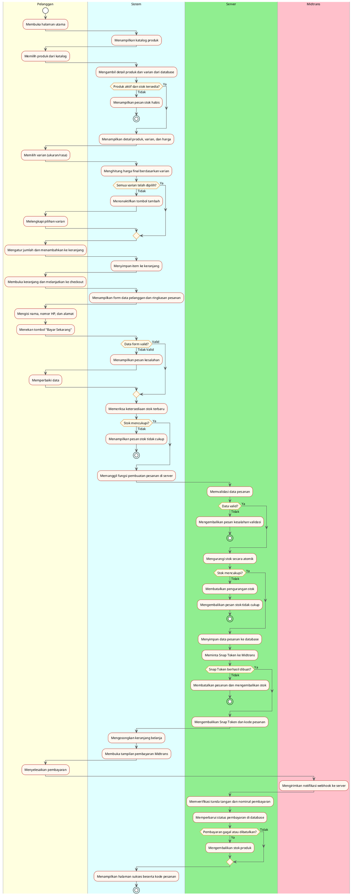

---

## Bagian 2: Activity Diagram Memeriksa Status Pesanan (Pelanggan)

**Aktor:** Pelanggan | Sistem | Server

**Tujuan:** Menggambarkan alur pelanggan memeriksa status pesanan menggunakan
kode pesanan dan nomor HP, termasuk kemungkinan melanjutkan pembayaran
yang masih tertunda.

**Kode Diagram (PlantUML):**

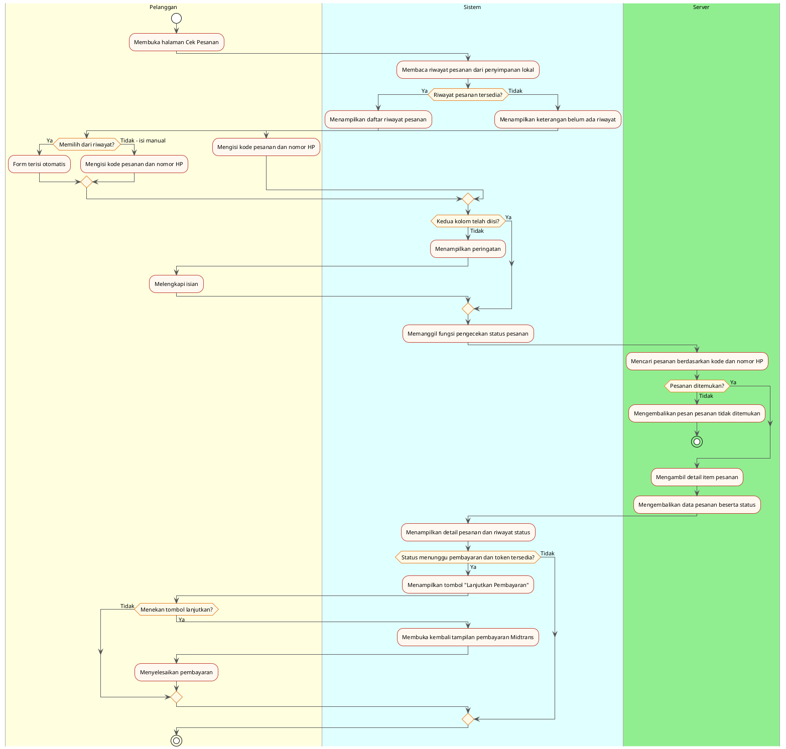

---

## Bagian 3: Activity Diagram Melakukan Login Admin

**Aktor:** Admin | Sistem | Supabase Auth

**Tujuan:** Menggambarkan proses autentikasi admin, termasuk verifikasi
whitelist tabel `admin` setelah login berhasil. Admin tidak dapat mengakses
dasbor apabila akunnya tidak terdaftar di tabel `admin`.

**Kode Diagram (PlantUML):**

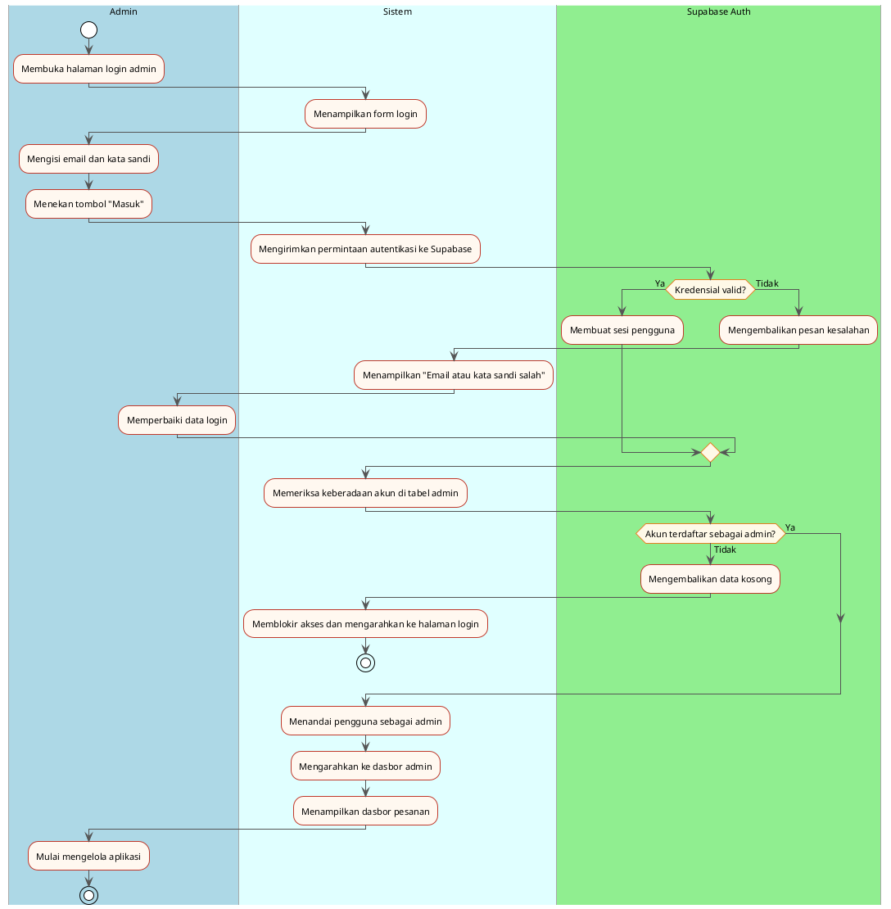

---

## Bagian 4: Activity Diagram Mengelola Kategori (Admin)

**Aktor:** Admin | Sistem | Database

**Tujuan:** Menggambarkan alur admin menambahkan, memperbarui, dan menghapus
kategori menu. Produk yang menggunakan kategori yang dihapus akan otomatis
menjadi tanpa kategori.

**Kode Diagram (PlantUML):**

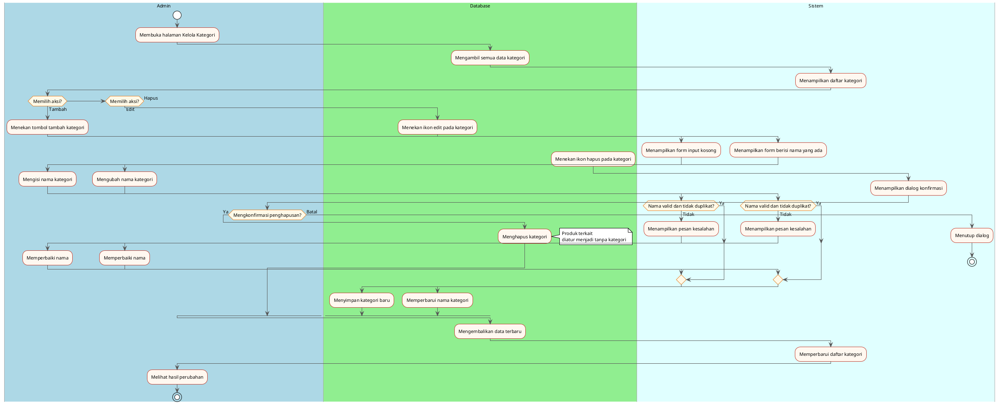

---

## Bagian 5: Activity Diagram Mengelola Produk dan Varian (Admin)

**Aktor:** Admin | Sistem | Database | Supabase Storage

**Tujuan:** Menggambarkan alur admin mengelola produk (tambah, ubah, hapus,
unggah gambar) dan mengelola varian produk seperti ukuran dan rasa melalui
modal pengelolaan varian.

**Kode Diagram (PlantUML):**

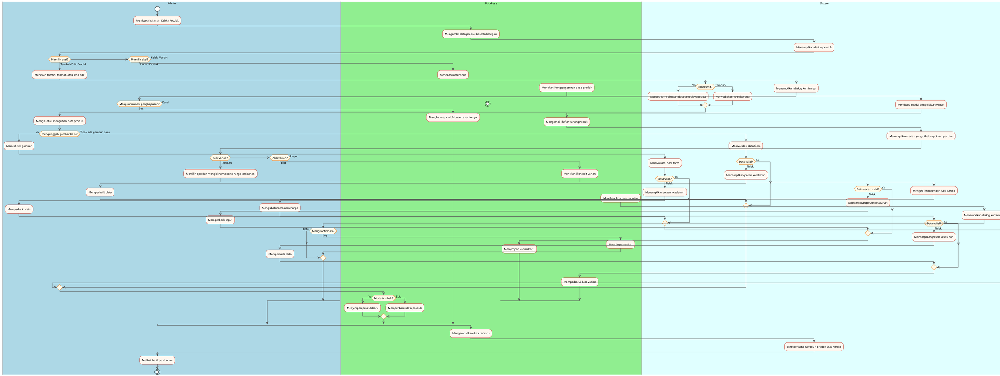

---

## Bagian 6: Activity Diagram Mengelola Pesanan (Admin)

**Aktor:** Admin | Sistem | Database

**Tujuan:** Menggambarkan alur admin memantau pesanan secara real-time,
melihat detail pesanan, dan memperbarui status pengiriman khusus untuk
pesanan yang sudah lunas.

**Kode Diagram (PlantUML):**

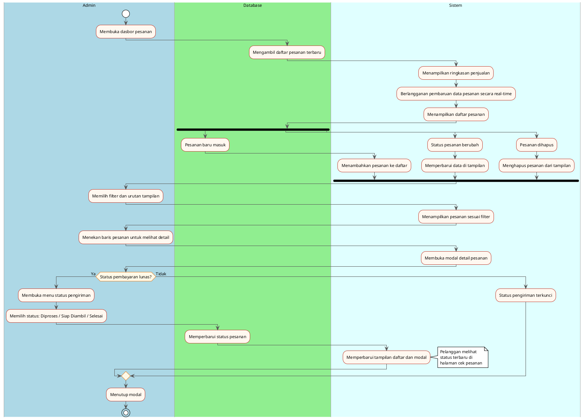

---

## Bagian 7: Activity Diagram Menggunakan Rekomendasi Budget (Pelanggan)

**Aktor:** Pelanggan | Sistem

**Tujuan:** Menggambarkan alur pelanggan menggunakan fitur rekomendasi budget
untuk mendapatkan paket menu yang optimal sesuai anggaran. Kalkulasi
dilakukan di sisi klien menggunakan data produk yang telah dimuat.

**Kode Diagram (PlantUML):**

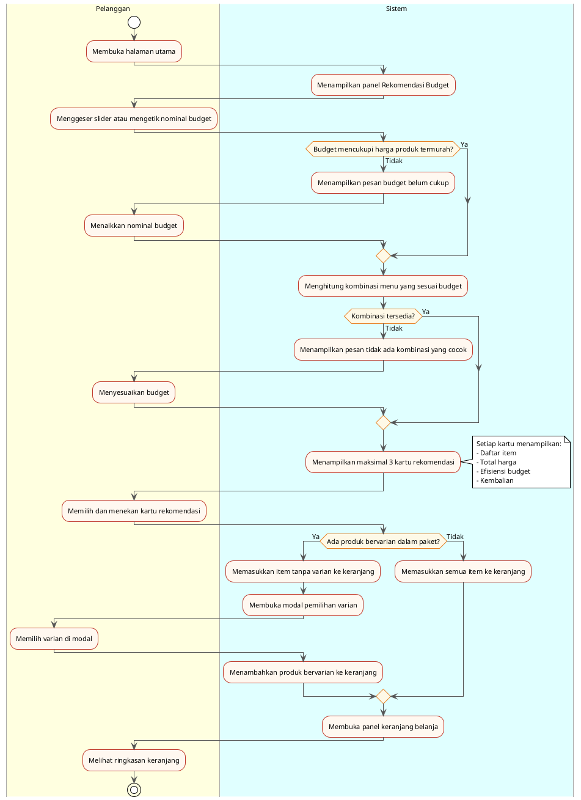

---

## Bagian 8: Activity Diagram Melihat Detail dan Memilih Varian Produk (Pelanggan)

**Aktor:** Pelanggan | Sistem | Database

**Tujuan:** Menggambarkan alur pelanggan membuka halaman detail produk,
memilih varian yang tersedia, melihat perubahan harga secara dinamis,
dan menambahkan produk ke keranjang.

**Kode Diagram (PlantUML):**

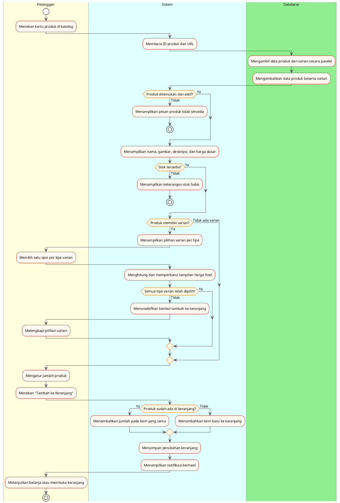

---

## Bagian 9: Activity Diagram Mengelola Keranjang Belanja (Pelanggan)

**Aktor:** Pelanggan | Sistem

**Tujuan:** Menggambarkan alur pelanggan melihat, mengubah jumlah, dan
menghapus item dalam keranjang sebelum melanjutkan ke proses checkout.

**Kode Diagram (PlantUML):**

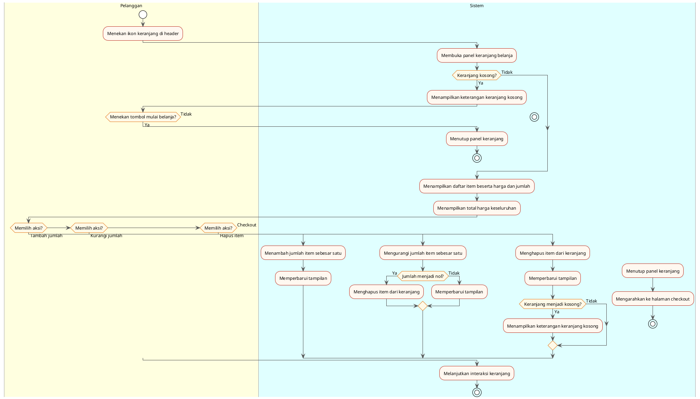

---

## Bagian 10: Activity Diagram Memproses Webhook Pembayaran (Sistem)

**Aktor:** Midtrans | Server | Database

**Tujuan:** Menggambarkan alur server memproses notifikasi pembayaran dari
Midtrans secara otomatis — mencakup verifikasi keamanan, pemeriksaan
idempotency, validasi nominal, pemetaan status, dan pengembalian stok
apabila pembayaran gagal.

**Kode Diagram (PlantUML):**

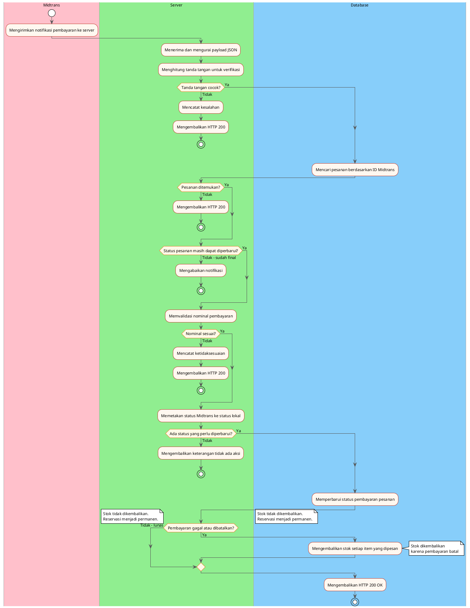

---

## Bagian 11: Activity Diagram Melihat Katalog dan Menyaring Kategori (Pelanggan)

**Aktor:** Pelanggan | Sistem | Database

**Tujuan:** Menggambarkan alur dasar penggunaan sistem — pelanggan membuka
aplikasi, sistem mengambil data produk dari database, dan pelanggan menyaring
tampilan berdasarkan kategori yang dipilih.

**Kode Diagram (PlantUML):**

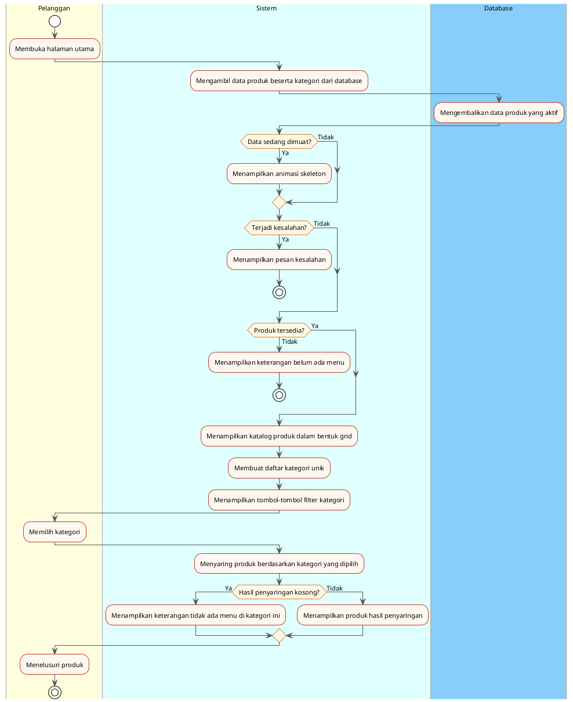
