# Activity Diagram Aplikasi Clucky Taiwan

Dokumen ini berisi **11 activity diagram** untuk sistem pemesanan makanan
**Clucky Taiwan** (React + Supabase + Midtrans). Setiap diagram menggunakan
format **PlantUML** dengan **swimlane** untuk menggambarkan peran masing-masing
aktor secara jelas.

**Cara render diagram:**
Salin kode di dalam blok ` ```plantuml ` ke salah satu tools berikut:
- [plantuml.com/plantuml/uml/](https://www.plantuml.com/plantuml/uml/)
- Ekstensi **PlantUML** di VS Code (Jebbs)
- Plugin PlantUML di IntelliJ / WebStorm

**Daftar Diagram:**
1. Pemesanan dan Pembayaran (Pelanggan)
2. Cek Status Pesanan (Pelanggan)
3. Login Admin
4. Kelola Kategori (Admin)
5. Kelola Produk dan Varian (Admin)
6. Kelola Pesanan (Admin)
7. Rekomendasi Budget (Pelanggan)
8. Melihat Detail & Memilih Varian Produk (Pelanggan)
9. Mengelola Keranjang Belanja (Pelanggan)
10. Pemrosesan Webhook Pembayaran (Sistem)
11. Melihat Katalog & Filter Kategori (Pelanggan)

---
## Bagian 1: Activity Diagram Pemesanan dan Pembayaran (Pelanggan)

**Aktor:** Pelanggan | Sistem | Server (Edge Function) | Midtrans

**Tujuan:** Menggambarkan alur lengkap pemesanan — dari memilih produk & varian,
mengisi checkout, proses server-side (validasi stok atomik, pesanan, Snap Token),
pembayaran via QRIS, hingga konfirmasi webhook dari Midtrans.

**Deskripsi Alur:**

Pelanggan membuka katalog, memilih produk, dan memilih varian (ukuran/rasa) yang
wajib dipilih jika tersedia. Harga berubah dinamis sesuai varian. Item disimpan ke
keranjang (Zustand + localStorage). Saat checkout, sistem memvalidasi form dan
melakukan pre-flight check stok. Jika lolos, Edge Function `create-order` dipanggil:
memvalidasi ulang, mengurangi stok atomik via RPC (dengan rollback jika gagal),
menyimpan pesanan, meminta Snap Token ke Midtrans, dan mengembalikan token.
Keranjang dikosongkan setelah pesanan masuk database. Pelanggan membayar via Snap
QRIS. Midtrans mengirim webhook; server memverifikasi signature, idempotency, dan
nominal — lalu memperbarui status pembayaran. Stok dikembalikan jika gagal/batal.

**Kode Diagram (PlantUML):**

```plantuml
@startuml
!theme plain
skinparam defaultFontName Arial
skinparam defaultFontSize 11
skinparam backgroundColor #FFFFFF
skinparam activityBackgroundColor #FFF8F0
skinparam activityBorderColor #C0392B
skinparam activityDiamondBackgroundColor #FEF9E7
skinparam activityDiamondBorderColor #E67E22
skinparam swimlaneBorderColor #AAAAAA
skinparam ArrowColor #555555

|#LightYellow|Pelanggan|
start
:Buka halaman utama;

|#LightCyan|Sistem|
:Tampilkan katalog produk;

|#LightYellow|Pelanggan|
:Pilih produk dari katalog;

|#LightCyan|Sistem|
:Fetch detail produk & opsi_varian\n(paralel dari Supabase);
if (Produk aktif & stok > 0?) then (Ya)
else (Tidak)
  :Tampilkan pesan error / overlay Stok Habis;
  stop
endif
:Tampilkan detail, varian, harga;

|#LightYellow|Pelanggan|
:Pilih varian per tipe (ukuran / rasa);
note right: Wajib pilih semua tipe\nyang tersedia

|#LightCyan|Sistem|
:Hitung harga final = harga dasar\n+ sum(harga_tambahan varian);
if (Semua varian terpilih?) then (Ya)
else (Tidak)
  :Disable tombol, tampilkan hint;
  |#LightYellow|Pelanggan|
  :Perbaiki pilihan varian;
  |#LightCyan|Sistem|
endif

|#LightYellow|Pelanggan|
:Atur jumlah (qty), klik\n"Tambah ke Keranjang";

|#LightCyan|Sistem|
:Simpan item ke keranjang\n(Zustand + localStorage);

|#LightYellow|Pelanggan|
:Buka keranjang, klik "Checkout";

|#LightCyan|Sistem|
:Tampilkan form data pelanggan\n& ringkasan belanja;

|#LightYellow|Pelanggan|
:Isi nama, nomor HP, alamat,\ncatatan (opsional);
:Klik "Bayar Sekarang";

|#LightCyan|Sistem|
if (Validasi form: nama, HP format,\nalamat min. 10 karakter?) then (Valid)
else (Tidak Valid)
  :Tampilkan error per field;
  |#LightYellow|Pelanggan|
  :Perbaiki data;
  |#LightCyan|Sistem|
endif
:Pre-flight: cek stok terbaru ke Supabase;
if (Stok cukup & produk aktif?) then (Ya)
else (Tidak)
  :Tampilkan error stok, hentikan;
  stop
endif
:Panggil Edge Function create-order;

|#LightGreen|Server (create-order)|
:Validasi payload: format HP,\nproduk valid, varian cocok, qty;
if (Payload valid?) then (Ya)
else (Tidak)
  :Return VALIDATION_ERROR;
  |#LightCyan|Sistem|
  :Tampilkan error;
  stop
endif
:Kurangi stok per produk\nvia RPC kurangi_stok (atomik);
if (Stok cukup semua item?) then (Ya)
else (Tidak — race condition)
  :Rollback stok yang sudah dikurangi;
  :Return INSUFFICIENT_STOCK;
  |#LightCyan|Sistem|
  :Tampilkan error;
  stop
endif
:INSERT pesanan ke tabel pesanan;
:INSERT detail_pesanan\n(snapshot varian dalam JSON);
:Request Snap Token ke Midtrans API;
if (Snap Token berhasil?) then (Ya)
else (Tidak)
  :Rollback: hapus pesanan,\nkembalikan stok;
  :Return PAYMENT_GATEWAY_ERROR;
  |#LightCyan|Sistem|
  :Tampilkan error;
  stop
endif
:UPDATE snap_token ke pesanan;
:Return: snap_token, kode_pesanan;

|#LightCyan|Sistem|
:Kosongkan keranjang belanja;
:Muat Midtrans Snap,\nbuka popup pembayaran QRIS;

|#LightYellow|Pelanggan|
if (Selesaikan pembayaran di Snap?) then (Ya)
else (Tutup popup)
  |#LightCyan|Sistem|
  :Simpan snap_token ke localStorage;
  :Tampilkan modal pilihan;
  if (Pilihan pelanggan?) then (Bayar Sekarang)
    :Buka kembali popup Snap;
    |#LightYellow|Pelanggan|
  else (Bayar Nanti)
    :Pesanan tersimpan pending,\ntoken bisa dipakai dari Cek Pesanan;
    stop
  endif
endif

|#Pink|Midtrans|
:Kirim notifikasi webhook POST\nke midtrans-webhook;

|#LightGreen|Server (midtrans-webhook)|
:Verifikasi SHA-512 signature;
if (Signature valid?) then (Ya)
else (Tidak)
  :Tolak, return HTTP 200;
  stop
endif
:Cari pesanan by midtrans_order_id;
if (Pesanan ditemukan?) then (Ya)
else (Tidak)
  :Return HTTP 200;
  stop
endif
if (Status pesanan sudah final?\n(idempotency)) then (Tidak)
else (Ya — sudah final)
  :Abaikan, return 200;
  stop
endif
:Validasi nominal pembayaran\n(toleransi Rp 1);
if (Nominal cocok?) then (Ya)
else (Tidak)
  :Tolak, return 200;
  stop
endif
:Mapping status Midtrans → status lokal;
if (Ada status yang perlu diperbarui?) then (Ya)
else (Tidak — status pending)
  stop
endif
:UPDATE status_pembayaran di pesanan;
if (Status = kadaluarsa/dibatalkan/ditolak?) then (Ya)
  :Kembalikan stok setiap item\nvia RPC tambah_stok;
else (Tidak — lunas)
  note right: Stok sudah permanen\ndari reservasi create-order
endif

|#LightCyan|Sistem|
:Realtime UPDATE / onSuccess\ncallback dipanggil;
:Simpan riwayat ke localStorage;
:Tampilkan halaman sukses\nbeserta kode pesanan (CTX-XXXXX);
stop
@enduml
```

---

## Bagian 2: Activity Diagram Cek Status Pesanan (Pelanggan)

**Aktor:** Pelanggan | Sistem | Server (Edge Function)

**Tujuan:** Menggambarkan alur pelanggan memeriksa status pesanan menggunakan
dua identitas (kode pesanan + nomor HP) sebagai mekanisme anti-enumeration,
termasuk kemungkinan melanjutkan pembayaran yang masih pending.

**Kode Diagram (PlantUML):**

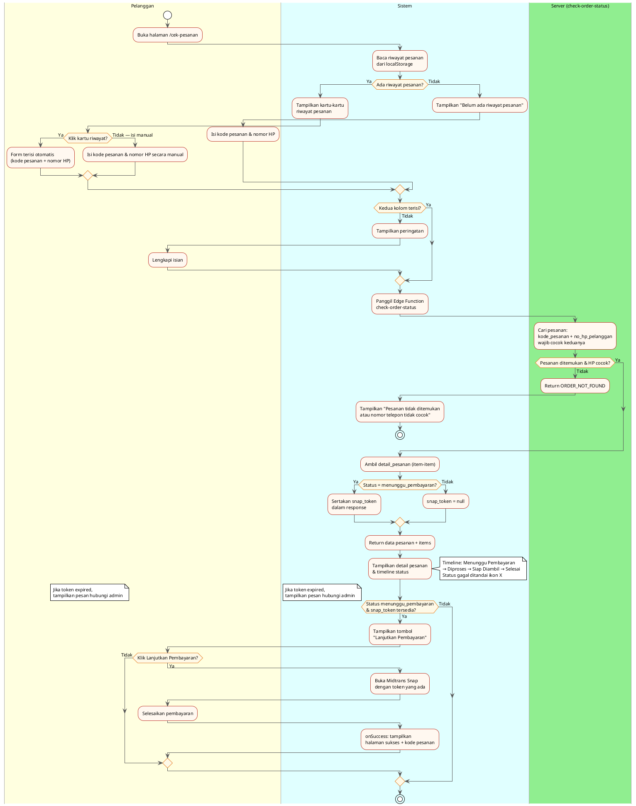

---

## Bagian 3: Activity Diagram Login Admin

**Aktor:** Admin | Sistem | Supabase Auth

**Tujuan:** Menggambarkan proses autentikasi admin, termasuk verifikasi whitelist
tabel `admin` setelah login berhasil. Admin tidak bisa mengakses dashboard jika
`user_id`-nya tidak terdaftar di tabel `admin`, meskipun password-nya benar.

**Kode Diagram (PlantUML):**

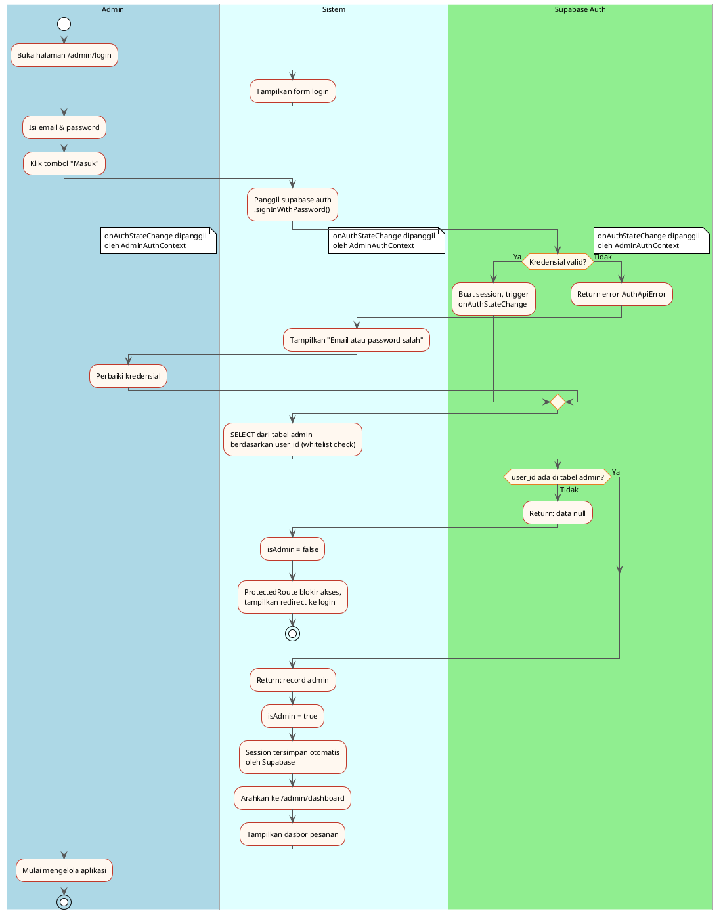

---

## Bagian 4: Activity Diagram Kelola Kategori (Admin)

**Aktor:** Admin | Sistem | Database

**Tujuan:** Menggambarkan alur admin membuat, memperbarui, dan menghapus kategori
menu. Produk yang menggunakan kategori yang dihapus akan otomatis menjadi tanpa
kategori (ON DELETE SET NULL).

**Kode Diagram (PlantUML):**

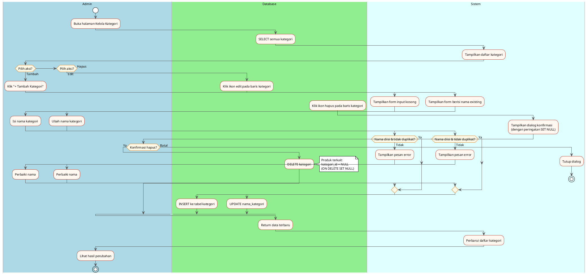

---

## Bagian 5: Activity Diagram Kelola Produk dan Varian (Admin)

**Aktor:** Admin | Sistem | Database | Supabase Storage

**Tujuan:** Menggambarkan alur admin mengelola produk (CRUD + upload gambar) dan
mengelola varian produk (ukuran/rasa dengan harga tambahan) melalui modal
VariantManager.

**Kode Diagram (PlantUML):**

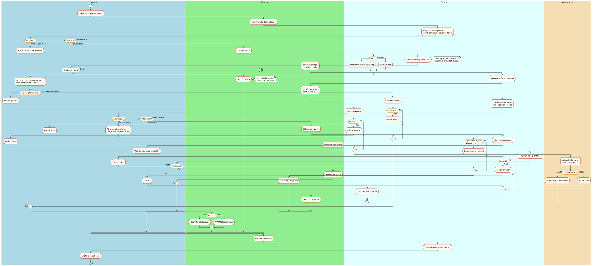

---

## Bagian 6: Activity Diagram Kelola Pesanan (Admin)

**Aktor:** Admin | Sistem | Database

**Tujuan:** Menggambarkan alur admin memantau pesanan secara real-time, melihat
detail, dan memperbarui status pengiriman (fulfillment status) khusus untuk
pesanan yang sudah lunas.

**Kode Diagram (PlantUML):**

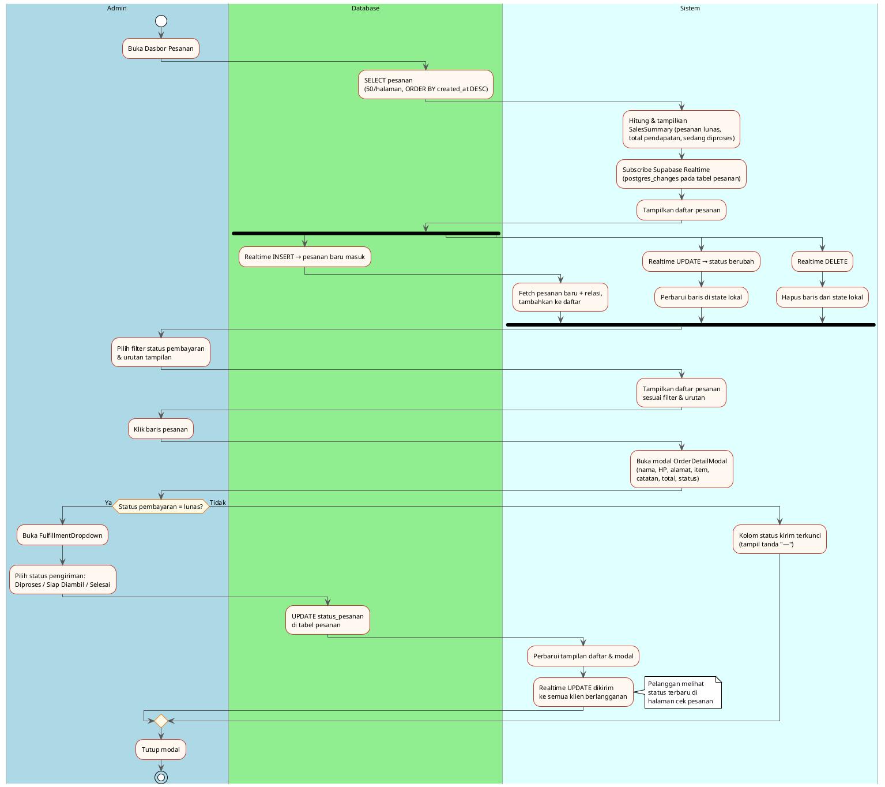

---

## Bagian 7: Activity Diagram Rekomendasi Budget (Pelanggan)

**Aktor:** Pelanggan | Sistem

**Tujuan:** Menggambarkan alur pelanggan menggunakan fitur rekomendasi budget
untuk mendapatkan paket menu optimal. Kalkulasi dilakukan di sisi klien
menggunakan data produk yang sudah dimuat — tanpa query tambahan ke database.

**Kode Diagram (PlantUML):**

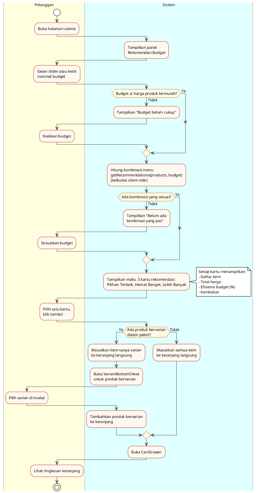

---

## Bagian 8: Activity Diagram Melihat Detail & Memilih Varian Produk (Pelanggan)

**Aktor:** Pelanggan | Sistem | Database

**Tujuan:** Menggambarkan alur pelanggan membuka halaman detail produk, memilih
varian (wajib jika tersedia), melihat perubahan harga dinamis, dan menambahkan
produk ke keranjang.

**Kode Diagram (PlantUML):**

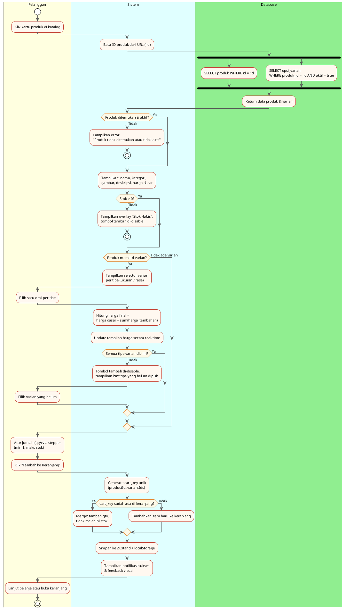

---

## Bagian 9: Activity Diagram Mengelola Keranjang Belanja (Pelanggan)

**Aktor:** Pelanggan | Sistem

**Tujuan:** Menggambarkan alur pelanggan melihat, mengubah jumlah, dan menghapus
item dalam keranjang sebelum melanjutkan ke checkout. Keranjang di-persist di
localStorage via Zustand middleware.

**Kode Diagram (PlantUML):**

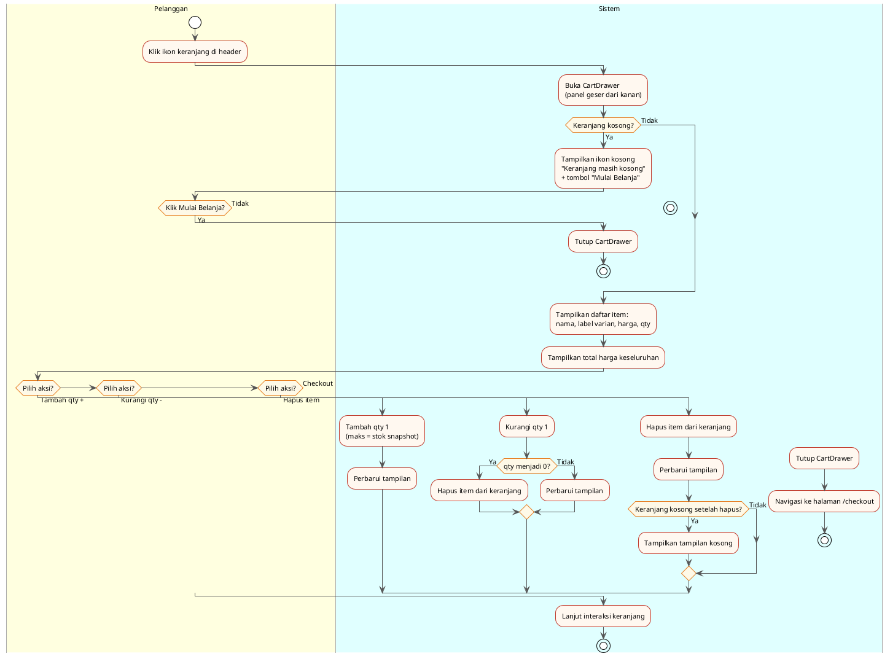

---

## Bagian 10: Activity Diagram Pemrosesan Webhook Pembayaran (Sistem)

**Aktor:** Midtrans | Server (midtrans-webhook) | Database

**Tujuan:** Menggambarkan alur server memproses notifikasi pembayaran dari Midtrans
secara otomatis — termasuk verifikasi keamanan (SHA-512 signature), idempotency,
validasi nominal, mapping status, dan pengembalian stok jika pembayaran gagal.

**Kode Diagram (PlantUML):**

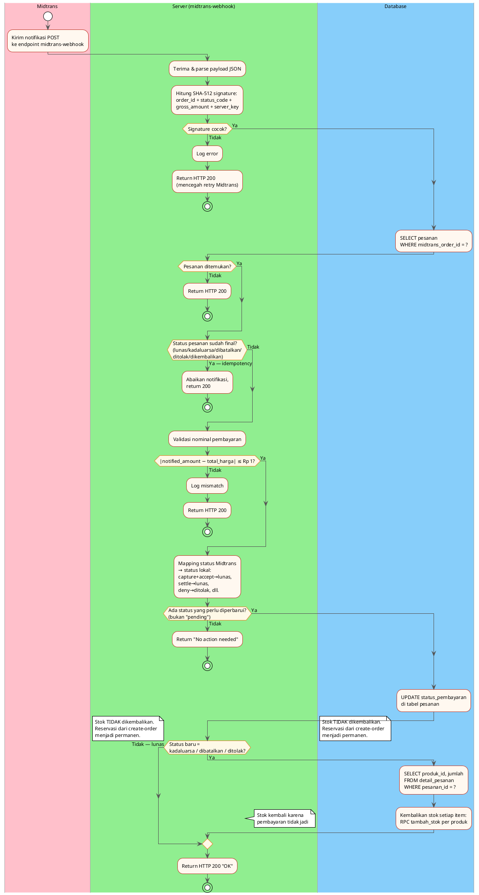

---

## Bagian 11: Activity Diagram Melihat Katalog & Filter Kategori (Pelanggan)

**Aktor:** Pelanggan | Sistem | Database

**Tujuan:** Menggambarkan alur dasar penggunaan sistem — pelanggan membuka aplikasi,
sistem mengambil data produk dari Supabase, dan pelanggan menyaring tampilan
berdasarkan kategori yang dipilih.

**Kode Diagram (PlantUML):**

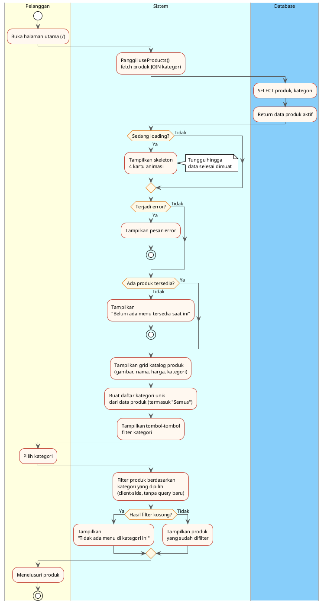
