# Use Case Diagram — Clucky Taiwan

Dokumen ini berisi **Use Case Diagram** dan **deskripsi setiap Use Case** untuk
sistem pemesanan makanan **Clucky Taiwan**, dibangun berdasarkan analisis source code
yang telah divalidasi.

---

## Use Case Diagram (PlantUML)

Salin kode berikut ke [PlantUML Online](https://www.plantuml.com/plantuml/uml/) atau
tool yang mendukung PlantUML untuk menghasilkan diagram.

```plantuml
@startuml Clucky Taiwan — Use Case Diagram

skinparam defaultFontName Arial
skinparam defaultFontSize 12
skinparam backgroundColor #FFFFFF
skinparam usecase {
  BackgroundColor #FFF8F0
  BorderColor #E77F86
  ArrowColor #555555
}
skinparam actor {
  BackgroundColor #FFF0F0
  BorderColor #C0392B
}
skinparam rectangle {
  BackgroundColor #FAFAFA
  BorderColor #AAAAAA
}
skinparam packageStyle rectangle

left to right direction

' ============================================================
' AKTOR
' ============================================================
actor "Pelanggan" as Pelanggan #LightYellow
actor "Admin" as Admin #LightBlue
actor "Midtrans\n(Payment Gateway)" as Midtrans #LightGray

' ============================================================
' SISTEM
' ============================================================
rectangle "Sistem Clucky Taiwan" {

  package "Katalog & Produk" {
    usecase "Melihat Katalog Produk" as UC01
    usecase "Filter Produk\nberdasarkan Kategori" as UC02
    usecase "Menggunakan\nRekomendasi Budget" as UC03
    usecase "Melihat Detail Produk" as UC04
    usecase "Memilih Varian Produk" as UC05
  }

  package "Keranjang & Pemesanan" {
    usecase "Menambahkan Produk\nke Keranjang" as UC06
    usecase "Mengelola\nKeranjang Belanja" as UC07
    usecase "Melakukan Checkout" as UC08
    usecase "Melakukan Pembayaran" as UC09
    usecase "Melanjutkan\nPembayaran Pending" as UC10
  }

  package "Status Pesanan" {
    usecase "Memeriksa\nStatus Pesanan" as UC11
    usecase "Melihat Riwayat\nPesanan" as UC12
  }

  package "Autentikasi" {
    usecase "Login Admin" as UC13
    usecase "Logout Admin" as UC14
  }

  package "Manajemen Pesanan" {
    usecase "Melihat Daftar Pesanan" as UC15
    usecase "Melihat Detail Pesanan" as UC16
    usecase "Memperbarui Status\nPengiriman" as UC17
    usecase "Memantau Dashboard\nPenjualan" as UC26
  }

  package "Manajemen Produk" {
    usecase "Menambahkan Produk" as UC18
    usecase "Mengedit Produk" as UC19
    usecase "Menghapus Produk" as UC20
    usecase "Mengunggah\nGambar Produk" as UC21
    usecase "Mengelola\nVarian Produk" as UC22
  }

  package "Manajemen Kategori" {
    usecase "Menambahkan Kategori" as UC23
    usecase "Mengedit Kategori" as UC24
    usecase "Menghapus Kategori" as UC25
  }
}

' ============================================================
' RELASI AKTOR — PELANGGAN
' ============================================================
Pelanggan --> UC01
Pelanggan --> UC02
Pelanggan --> UC03
Pelanggan --> UC04
Pelanggan --> UC06
Pelanggan --> UC07
Pelanggan --> UC08
Pelanggan --> UC10
Pelanggan --> UC11
Pelanggan --> UC12

' ============================================================
' RELASI AKTOR — ADMIN
' ============================================================
Admin --> UC13
Admin --> UC14
Admin --> UC15
Admin --> UC17
Admin --> UC18
Admin --> UC19
Admin --> UC20
Admin --> UC22
Admin --> UC23
Admin --> UC24
Admin --> UC25

' ============================================================
' RELASI AKTOR — MIDTRANS
' ============================================================
Midtrans --> UC09 : mengirim notifikasi\nwebhook pembayaran

' ============================================================
' RELASI INCLUDE / EXTEND
' ============================================================
UC04 <.. UC05 : <<include>>
UC06 <.. UC05 : <<extend>>\n[jika produk bervarian]
UC08 <.. UC09 : <<include>>
UC18 <.. UC21 : <<include>>
UC19 <.. UC21 : <<include>>
UC15 <.. UC16 : <<extend>>
UC15 <.. UC17 : <<extend>>\n[status_pembayaran = lunas]
UC15 <.. UC26 : <<include>>
UC18 <.. UC22 : <<extend>>
UC19 <.. UC22 : <<extend>>

@enduml
```

---

## Deskripsi Use Case

### UC-01 — Melihat Katalog Produk

| Atribut | Detail |
|---|---|
| **Nama** | Melihat Katalog Produk |
| **Aktor** | Pelanggan |
| **Precondition** | Pelanggan membuka halaman utama (`/`) |
| **Postcondition** | Daftar produk aktif ditampilkan |
| **Alur Utama** | 1. Sistem mengambil data produk dari tabel `produk` JOIN `kategori`. 2. Sistem menampilkan produk dalam grid beserta gambar, nama, harga, dan kategori. |
| **Alur Alternatif** | - Loading: tampilkan skeleton animasi. - Error: tampilkan pesan error. - Tidak ada produk: tampilkan "Belum ada menu tersedia." |
| **Implementasi** | `src/pages/public/HomePage.jsx`, `src/hooks/useProducts.js` |

---

### UC-02 — Filter Produk berdasarkan Kategori

| Atribut | Detail |
|---|---|
| **Nama** | Filter Produk berdasarkan Kategori |
| **Aktor** | Pelanggan |
| **Precondition** | Katalog produk sudah ditampilkan |
| **Postcondition** | Daftar produk difilter sesuai kategori yang dipilih |
| **Alur Utama** | 1. Sistem membuat daftar kategori unik dari produk yang ada. 2. Pelanggan mengklik tombol kategori. 3. Sistem memfilter produk sesuai pilihan. |
| **Alur Alternatif** | - Hasil filter kosong: tampilkan "Tidak ada menu di kategori ini." |
| **Implementasi** | `src/pages/public/HomePage.jsx` (L19–27) |

---

### UC-03 — Menggunakan Rekomendasi Budget

| Atribut | Detail |
|---|---|
| **Nama** | Menggunakan Rekomendasi Budget |
| **Aktor** | Pelanggan |
| **Precondition** | Produk berhasil dimuat |
| **Postcondition** | Pelanggan mendapat rekomendasi paket menu sesuai budget |
| **Alur Utama** | 1. Pelanggan menggeser slider atau mengetik nominal budget. 2. Sistem menghitung kombinasi menu (maks. 3 paket). 3. Sistem menampilkan kartu rekomendasi: total harga, efisiensi (%), kembalian. 4a. Paket tanpa varian → langsung masuk keranjang. 4b. Paket ada varian → buka modal pemilihan varian. |
| **Alur Alternatif** | - Budget < harga termurah: "Budget belum cukup." - Tidak ada kombinasi: "Belum ada kombinasi yang pas." |
| **Implementasi** | `src/components/BudgetRecommender.jsx` |

---

### UC-04 — Melihat Detail Produk

| Atribut | Detail |
|---|---|
| **Nama** | Melihat Detail Produk |
| **Aktor** | Pelanggan |
| **Precondition** | Pelanggan mengklik kartu produk |
| **Postcondition** | Detail produk ditampilkan |
| **Alur Utama** | 1. Sistem membaca ID dari URL (`:id`). 2. Sistem fetch `produk` + `opsi_varian` secara paralel. 3. Menampilkan nama, harga, stok, deskripsi, gambar, varian. |
| **Alur Alternatif** | - Produk tidak aktif: error "Produk tidak ditemukan atau tidak aktif." - Stok = 0: overlay "Stok Habis", tombol tambah di-disable. |
| **Implementasi** | `src/pages/public/ProductDetailPage.jsx` (L46–103) |

---

### UC-05 — Memilih Varian Produk

| Atribut | Detail |
|---|---|
| **Nama** | Memilih Varian Produk |
| **Aktor** | Pelanggan |
| **Precondition** | Produk memiliki varian (ukuran dan/atau rasa) |
| **Postcondition** | Semua varian terpilih, harga diperbarui |
| **Alur Utama** | 1. Sistem mengelompokkan varian per tipe. 2. Pelanggan memilih satu opsi per tipe. 3. Harga final = harga dasar + sum(harga_tambahan varian). |
| **Alur Alternatif** | - Varian belum semua dipilih: tombol tambah di-disable + hint muncul. - Datang dari rekomendasi budget: varian dipilihkan otomatis, bisa diubah. |
| **Implementasi** | `src/pages/public/ProductDetailPage.jsx` (L107–141) |

---

### UC-06 — Menambahkan Produk ke Keranjang

| Atribut | Detail |
|---|---|
| **Nama** | Menambahkan Produk ke Keranjang |
| **Aktor** | Pelanggan |
| **Precondition** | Stok > 0; semua varian wajib sudah dipilih |
| **Postcondition** | Item tersimpan di keranjang (Zustand + localStorage) |
| **Alur Utama** | 1. Pelanggan mengatur qty (min 1, maks stok). 2. Tekan "Tambah ke Keranjang". 3. Sistem simpan item dengan `cart_key` unik (productId + variantIds). |
| **Alur Alternatif** | - Kombinasi sudah ada: qty digabung (merge), tidak melebihi stok. |
| **Implementasi** | `src/store/cartStore.js` (`addItem()`), `src/pages/public/ProductDetailPage.jsx` (L144–172) |

---

### UC-07 — Mengelola Keranjang Belanja

| Atribut | Detail |
|---|---|
| **Nama** | Mengelola Keranjang Belanja |
| **Aktor** | Pelanggan |
| **Precondition** | Keranjang memiliki setidaknya satu item |
| **Postcondition** | Qty diperbarui atau item dihapus |
| **Alur Utama** | 1. Buka CartDrawer (panel geser kanan). 2. Tampilkan semua item beserta nama, varian, harga, qty. 3. Ubah qty via `+`/`−` atau hapus item. |
| **Alur Alternatif** | - Qty dikurangi jadi 0: item otomatis dihapus. - Keranjang kosong: tampilkan pesan kosong. |
| **Implementasi** | `src/components/CartDrawer.jsx`, `src/store/cartStore.js` |

---

### UC-08 — Melakukan Checkout

| Atribut | Detail |
|---|---|
| **Nama** | Melakukan Checkout |
| **Aktor** | Pelanggan |
| **Precondition** | Keranjang tidak kosong |
| **Postcondition** | Pesanan masuk ke database, Snap Token diterima |
| **Alur Utama** | 1. Pelanggan mengisi nama, nomor HP, alamat, catatan (opsional). 2. Sistem validasi form di client. 3. Pre-flight check stok terbaru ke Supabase. 4. Panggil Edge Function `create-order`. 5. Server: validasi ulang → kurangi stok → buat pesanan → minta Snap Token. 6. Keranjang dikosongkan setelah pesanan masuk database. |
| **Alur Alternatif** | - Validasi gagal: error per field. - Stok tidak cukup (client): hentikan, error. - Stok tidak cukup (server, race condition): rollback + error. - Midtrans gagal: rollback pesanan dan stok. |
| **Implementasi** | `src/components/CheckoutForm.jsx`, `supabase/functions/create-order/index.ts` |

---

### UC-09 — Melakukan Pembayaran

| Atribut | Detail |
|---|---|
| **Nama** | Melakukan Pembayaran |
| **Aktor** | Pelanggan, Midtrans |
| **Precondition** | Snap Token diterima dari UC-08 |
| **Postcondition** | Status pembayaran diperbarui di database |
| **Alur Utama** | 1. Sistem buka Snap popup (QRIS). 2. Pelanggan selesaikan pembayaran. 3. Midtrans kirim webhook ke `midtrans-webhook`. 4. Sistem verifikasi signature SHA-512 + idempotency + validasi nominal. 5. Update `status_pembayaran` di `pesanan`. 6. Jika lunas: Realtime atau callback `onSuccess` → halaman sukses. |
| **Alur Alternatif** | - Snap ditutup: simpan token ke localStorage, modal "Bayar Sekarang/Nanti". - Gagal/batal/kadaluarsa: stok dikembalikan. |
| **Implementasi** | `src/components/CheckoutForm.jsx`, `supabase/functions/midtrans-webhook/index.ts` |

---

### UC-10 — Melanjutkan Pembayaran Pending

| Atribut | Detail |
|---|---|
| **Nama** | Melanjutkan Pembayaran Pending |
| **Aktor** | Pelanggan |
| **Precondition** | Ada Snap Token di localStorage (< 23 jam) |
| **Postcondition** | Pembayaran diselesaikan atau ditunda |
| **Alur Utama** | 1. Sistem deteksi token pending di localStorage saat halaman checkout dibuka. 2. Tampilkan banner "Ada pesanan yang belum dibayar". 3. Pelanggan tekan "Lanjutkan Bayar" → Snap popup dibuka. |
| **Alur Alternatif** | - Token expired (> 23 jam): token dihapus, banner tidak muncul. - Dismiss: token dihapus. |
| **Implementasi** | `src/pages/public/CheckoutPage.jsx`, `src/components/CheckoutForm.jsx` |

---

### UC-11 — Memeriksa Status Pesanan

| Atribut | Detail |
|---|---|
| **Nama** | Memeriksa Status Pesanan |
| **Aktor** | Pelanggan |
| **Precondition** | Pelanggan memiliki kode pesanan dan nomor HP terdaftar |
| **Postcondition** | Status dan detail pesanan ditampilkan |
| **Alur Utama** | 1. Buka `/cek-pesanan`. 2. Isi kode pesanan + nomor HP → klik "Cek". 3. Panggil Edge Function `check-order-status` (2 identitas wajib cocok). 4. Tampilkan timeline status: Menunggu Pembayaran → Diproses → Siap Diambil → Selesai. |
| **Alur Alternatif** | - Kode/HP tidak cocok: "Pesanan tidak ditemukan." - Status gagal: ikon X + pesan. - Status pending + token tersedia: tombol "Lanjutkan Pembayaran". - Status pending + token expired: pesan "hubungi admin." |
| **Implementasi** | `src/components/OrderStatusChecker.jsx`, `supabase/functions/check-order-status/index.ts` |

---

### UC-12 — Melihat Riwayat Pesanan

| Atribut | Detail |
|---|---|
| **Nama** | Melihat Riwayat Pesanan |
| **Aktor** | Pelanggan |
| **Precondition** | Pelanggan pernah memesan dari perangkat yang sama |
| **Postcondition** | Daftar pesanan sebelumnya ditampilkan |
| **Alur Utama** | 1. Sistem baca riwayat dari `localStorage` saat `/cek-pesanan` dibuka. 2. Tampilkan kartu pesanan: kode, tanggal, total. 3. Klik kartu → form terisi otomatis + cek status langsung dijalankan. |
| **Alur Alternatif** | - Belum ada riwayat: "Belum ada riwayat pesanan." |
| **Implementasi** | `src/components/OrderStatusChecker.jsx` (L169–190), `src/utils/storage.js` |

---

### UC-13 — Login Admin

| Atribut | Detail |
|---|---|
| **Nama** | Login Admin |
| **Aktor** | Admin |
| **Precondition** | Admin mengakses `/admin/login` |
| **Postcondition** | Sesi admin aktif, masuk ke dashboard |
| **Alur Utama** | 1. Isi email + password → tekan "Masuk". 2. Sistem panggil `supabase.auth.signInWithPassword()`. 3. Sistem cek tabel `admin` (whitelist) berdasarkan `user_id`. 4. Jika lolos: `isAdmin = true` → redirect `/admin/dashboard`. |
| **Alur Alternatif** | - Kredensial salah: "Email atau password salah." - Login berhasil tapi tidak di whitelist: `isAdmin = false`, akses diblokir. |
| **Implementasi** | `src/pages/admin/AdminLogin.jsx`, `src/context/AdminAuthContext.jsx` |

---

### UC-14 — Logout Admin

| Atribut | Detail |
|---|---|
| **Nama** | Logout Admin |
| **Aktor** | Admin |
| **Precondition** | Admin sedang login |
| **Postcondition** | Sesi dihapus, redirect ke halaman login |
| **Alur Utama** | 1. Admin tekan tombol logout. 2. Sistem panggil `supabase.auth.signOut()`. 3. State diperbarui: `session = null`, `isAdmin = false`. 4. `ProtectedRoute` redirect ke `/admin/login`. |
| **Implementasi** | `src/context/AdminAuthContext.jsx` (`logout()`) |

---

### UC-15 — Melihat Daftar Pesanan

| Atribut | Detail |
|---|---|
| **Nama** | Melihat Daftar Pesanan |
| **Aktor** | Admin |
| **Precondition** | Admin sudah login |
| **Postcondition** | Daftar pesanan + ringkasan penjualan ditampilkan |
| **Alur Utama** | 1. Sistem fetch pesanan dari Supabase (50/halaman, urut terbaru). 2. Sistem subscribe Realtime untuk auto-update. 3. Admin dapat filter status pembayaran dan ubah urutan. |
| **Alur Alternatif** | - Realtime INSERT: fetch pesanan baru + relasi. - Realtime UPDATE/DELETE: perbarui/hapus dari state lokal. |
| **Implementasi** | `src/pages/admin/AdminOrders.jsx`, `src/components/admin/SalesSummary.jsx` |

---

### UC-16 — Melihat Detail Pesanan

| Atribut | Detail |
|---|---|
| **Nama** | Melihat Detail Pesanan |
| **Aktor** | Admin |
| **Precondition** | Admin berada di halaman Daftar Pesanan |
| **Postcondition** | Modal detail pesanan ditampilkan |
| **Alur Utama** | 1. Admin klik baris pesanan. 2. Modal `OrderDetailModal` terbuka dengan data lengkap: pelanggan, item, catatan, total, status. |
| **Implementasi** | `src/components/admin/OrderDetailModal.jsx` |

---

### UC-17 — Memperbarui Status Pengiriman

| Atribut | Detail |
|---|---|
| **Nama** | Memperbarui Status Pengiriman |
| **Aktor** | Admin |
| **Precondition** | Status pembayaran pesanan = "lunas" |
| **Postcondition** | `status_pesanan` diperbarui di database |
| **Alur Utama** | 1. Admin buka dropdown `FulfillmentDropdown` pada baris pesanan lunas. 2. Pilih status: Diproses / Siap Diambil / Selesai. 3. Sistem UPDATE `status_pesanan` di database. 4. Realtime menyiarkan update ke klien lain. |
| **Alur Alternatif** | - Pesanan belum lunas: dropdown tidak ditampilkan. |
| **Implementasi** | `src/components/admin/FulfillmentDropdown.jsx`, `src/pages/admin/AdminOrders.jsx` (L89–101) |

---

### UC-18 — Menambahkan Produk

| Atribut | Detail |
|---|---|
| **Nama** | Menambahkan Produk |
| **Aktor** | Admin |
| **Precondition** | Admin berada di halaman Kelola Produk |
| **Postcondition** | Produk baru tersimpan di tabel `produk` |
| **Alur Utama** | 1. Tekan "Tambah Produk" → isi nama, deskripsi, harga, stok, kategori, gambar, status aktif. 2. Validasi data. 3. Jika ada gambar: upload ke Storage → ambil URL publik. 4. INSERT ke tabel `produk`. |
| **Alur Alternatif** | - Nama/kategori kosong: error validasi. - Upload gagal: error, tidak lanjut simpan. |
| **Implementasi** | `src/pages/admin/AdminProducts.jsx` (L57–139) |

---

### UC-19 — Mengedit Produk

| Atribut | Detail |
|---|---|
| **Nama** | Mengedit Produk |
| **Aktor** | Admin |
| **Precondition** | Produk sudah ada di daftar |
| **Postcondition** | Data produk diperbarui |
| **Alur Utama** | 1. Klik ikon edit → form terisi data existing. 2. Admin ubah field → validasi → UPDATE `produk`. |
| **Implementasi** | `src/pages/admin/AdminProducts.jsx` (L65–139 dengan `editingId`) |

---

### UC-20 — Menghapus Produk

| Atribut | Detail |
|---|---|
| **Nama** | Menghapus Produk |
| **Aktor** | Admin |
| **Precondition** | Produk ada di daftar |
| **Postcondition** | Produk dihapus dari tabel `produk` |
| **Alur Utama** | 1. Klik ikon hapus → dialog konfirmasi muncul. 2. Admin konfirmasi → DELETE `produk`. |
| **Alur Alternatif** | - Admin batal: dialog tutup, tidak ada perubahan. |
| **Implementasi** | `src/pages/admin/AdminProducts.jsx` (L141–149, L315–345) |

---

### UC-21 — Mengunggah Gambar Produk

| Atribut | Detail |
|---|---|
| **Nama** | Mengunggah Gambar Produk |
| **Aktor** | Admin |
| **Precondition** | Sedang dalam proses tambah/edit produk |
| **Postcondition** | Gambar tersimpan di Supabase Storage, URL disimpan di `produk.url_gambar` |
| **Alur Utama** | 1. Admin pilih file gambar. 2. Sistem generate nama file unik (timestamp + random). 3. Upload ke bucket `product-images`. 4. Ambil public URL → simpan bersama data produk. |
| **Alur Alternatif** | - Upload gagal: error, batalkan penyimpanan produk. |
| **Implementasi** | `src/pages/admin/AdminProducts.jsx` (L96–114) |

---

### UC-22 — Mengelola Varian Produk

| Atribut | Detail |
|---|---|
| **Nama** | Mengelola Varian Produk |
| **Aktor** | Admin |
| **Precondition** | Admin berada di halaman Kelola Produk |
| **Postcondition** | Varian tersimpan/diperbarui/dihapus di tabel `opsi_varian` |
| **Alur Utama** | 1. Klik ikon Settings pada baris produk → modal `VariantManager` terbuka. 2. **Tambah:** pilih tipe (ukuran/rasa), isi nama + harga tambahan → validasi → INSERT. 3. **Edit:** pilih varian → ubah nama/harga → UPDATE. 4. **Hapus:** tekan hapus → konfirmasi → DELETE. |
| **Alur Alternatif** | - Nama duplikat dalam tipe yang sama: "Varian sudah ada pada tipe ini." |
| **Implementasi** | `src/components/admin/VariantManager.jsx` |

---

### UC-23 — Menambahkan Kategori

| Atribut | Detail |
|---|---|
| **Nama** | Menambahkan Kategori |
| **Aktor** | Admin |
| **Precondition** | Admin berada di halaman Kelola Kategori |
| **Postcondition** | Kategori baru tersimpan di tabel `kategori` |
| **Alur Utama** | 1. Tekan "Tambah Kategori" → isi nama. 2. Validasi: nama wajib diisi, tidak boleh duplikat. 3. INSERT ke tabel `kategori`. |
| **Implementasi** | `src/pages/admin/AdminCategories.jsx` (L30–73) |

---

### UC-24 — Mengedit Kategori

| Atribut | Detail |
|---|---|
| **Nama** | Mengedit Kategori |
| **Aktor** | Admin |
| **Precondition** | Kategori ada di daftar |
| **Postcondition** | Nama kategori diperbarui |
| **Alur Utama** | 1. Klik ikon edit → form terisi nama existing. 2. Admin ubah nama → validasi → UPDATE. |
| **Implementasi** | `src/pages/admin/AdminCategories.jsx` (L37–73) |

---

### UC-25 — Menghapus Kategori

| Atribut | Detail |
|---|---|
| **Nama** | Menghapus Kategori |
| **Aktor** | Admin |
| **Precondition** | Kategori ada di daftar |
| **Postcondition** | Kategori dihapus (produk yang menggunakannya menjadi tanpa kategori — `SET NULL`) |
| **Alur Utama** | 1. Klik ikon hapus → dialog konfirmasi muncul (dengan peringatan SET NULL). 2. Admin konfirmasi → DELETE `kategori`. |
| **Implementasi** | `src/pages/admin/AdminCategories.jsx` (L75–83) |

---

### UC-26 — Memantau Dashboard Penjualan

| Atribut | Detail |
|---|---|
| **Nama** | Memantau Dashboard Penjualan |
| **Aktor** | Admin |
| **Precondition** | Admin berada di halaman Daftar Pesanan |
| **Postcondition** | Ringkasan penjualan ditampilkan |
| **Alur Utama** | Sistem menghitung 3 metrik otomatis dari data pesanan yang dimuat: 1. **Pesanan Lunas** — jumlah dengan `status_pembayaran = lunas`. 2. **Total Pendapatan** — total `total_harga` dari pesanan lunas. 3. **Sedang Diproses** — pesanan lunas yang belum berstatus "selesai". |
| **Implementasi** | `src/components/admin/SalesSummary.jsx` |
